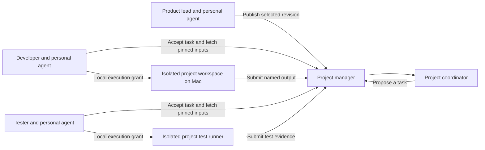

# Team projects with personal agents

Design proposal for [#11178](https://github.com/nwverse/persona/issues/11178). It is for people who deliver a project together and want each person's agent to work from the same decisions. The proposed first release is a Web pilot for a small, invitation-only team.

A product lead should be able to say “Publish the approved refund requirements to Checkout”. A developer can then ask “Design the API on my Mac”, and a tester can ask “Draft coverage for those requirements”. Each should be able to open the exact revision their agent used. A member should be able to do all three without giving anyone access to their private chats or a general-purpose login to their computer.

## A requirement from draft to delivery

| Step | What a person sees | What the project records |
| --- | --- | --- |
| Publish | The product lead selects text and attachments from a private conversation, previews the complete snapshot and its project audience, then confirms. A reviewer with approval rights marks revision 1 current. | Requirement ID, immutable revision, author, digest, audience, approver and approval time. Publishing further turns requires a new selection. |
| Design | In the project conversation the developer asks for an API design. The coordinator shows the approved requirement, proposed assignee and intended workspace. The developer accepts the assignment. | Task owner, pinned requirement revision and, when work starts, effective execution grant. The design cites the requirement it implements. |
| Build and test | Frontend and backend work in parallel. QA can design tests immediately. When the implementation reviewers accept both outputs, the integrator publishes a candidate for QA and code review. | Accepted output revisions, candidate ID, test run and evidence. Every reviewer receives the same candidate. |
| Revise | Product changes the refund window from seven days to fourteen. On approval of revision 2, owners of tasks consuming revision 1 see the diff and a request to reassess. | An assignee adopts v2, blocks the task or requests an exception. The requirement approver must accept an exception against the named task and revision before it can count toward release. Original evidence still points to v1. |
| Decide | The coordinator shows which requirements, changes and test results apply. A designated release approver can accept when the candidate satisfies the project's policy. | The decision pins approved inputs, candidate, exceptions and evidence. A changed component produces a new candidate and reopens candidate-specific checks. |

A project conversation is visible to its members and labeled with its audience before the first message. A private assistant can suggest publishing an extract. The member chooses the destination and sees its exact contents. Project search and the coordinator can read only published project records. A personal agent receives the selected task inputs. It may work on a private draft and offer an explicit result for publication.

On the Web, a member opens a named project from an optional Projects entry. The project opens on its conversation with the coordinator. A “Current documents” view shows the approved PRD, design and their owners. A “Work” view shows assignments and blockers. The task detail shows “Inputs used” with revision links, so a tester can open the same PRD as the developer. Member and machine settings sit under project settings. The initial invitation names the team operator and what existing project content a new member may read.

## Deployment and authority

Use one opt-in project manager as the authority for a project. It can be deployed alongside a hub, with its own credential audience and project-scoped storage. Each member's personal installation keeps its own identity, chats, connectors, machine credentials and model configuration. Project conversations and published material are readable by the team service operator under the proposed self-hosted trust model. The proposed pilot assumes the team trusts that operator.

| Decision | Who authorizes it | Scope |
| --- | --- | --- |
| Join or remove a member | Project administrator | One project. Redeeming a single-use, expiring invite binds it to an authenticated human identity. |
| Read, discuss or publish | Active member with the relevant capability | One project and its shared content. Guests can be invited as readers. Explicit publication previews the audience and attachments. |
| Approve a requirement or a release | Named human approver under project policy | A particular revision or release candidate. Record the actor and policy in effect. |
| Accept a task output | Reviewer designated by project policy | A submitted output revision against its pinned inputs. Submission alone leaves the task awaiting acceptance. |
| Offer a machine | Machine owner in their personal installation | One project, isolated workspace, allowed launcher, permitted operations, capacity and expiry. The owner can require approval per assignment. |
| Assign and execute | Coordinator proposes, project manager checks policy, member's runner checks local consent | One task attempt with pinned inputs, acting principal, owner and grant revision. Grants can limit concurrent use and chargeable runs. |

Give the pilot its own project-scoped sign-in or verified identity binding. Use a stable issuer and subject. Multiple devices can represent a person. The server derives identity and project membership from authenticated credentials. Invites only enroll members. The coordinator has a service identity with project read and task-proposal capabilities. Its rights to send work are bounded by recorded human decisions. Membership alone grants no terminal, SSH, file browsing or personal tool access.

**Why a separate authority?** Mesh links route applications and nodes to one trusted primary. Its own documentation limits pairing to a person's own hubs. Giving colleagues the existing full-role device credential would grant personal APIs whose queries assume one owner. Adding a project filter to the Web client would still leave those APIs and their event streams exposed. An extension can prototype the artifact catalog and views. Enforcing independent user identities and execution grants requires server and runner support. [Mesh trust](../../server/mesh.md#security-boundaries) · [Existing credential and owner binding](../../server/agent-sharing.md#trusted-ownership) · [Spaces extension](https://github.com/nwverse/persona-extensions/blob/main/docs/extensions/spaces.md)

## Data and handoff contract

| Record | Identity and invariants |
| --- | --- |
| Project and membership | Project ID, issuer and member subject, role, status and revision. Scope queries, subscriptions, attachment downloads, search indexes, caches and audit reads to authorized projects. |
| Artifact and revision | Stable project artifact ID, immutable revision ID, author, content digest, attachment digests and approval history. “Current approved” is a pointer. Concurrent publication or approval checks the expected previous revision and returns a conflict if it changed. |
| Task and assignment | Project task ID, accountable member, required input revisions, predecessor task IDs, designated workspace and output contract. Record which exact inputs and provider profile the member accepts. Readiness and any final release decision use persisted facts. |
| Grant and attempt | Local grant ID and revision, opaque workspace ID, allowed operations, lease expiry, assignment generation and idempotency key. The team sees the capabilities offered. The local owner keeps secrets and the mapping to an OS workspace. |
| Release candidate | The designated integrator publishes an immutable manifest with the accepted outputs, repository-to-commit mapping, applicable build or image digests and retrieval routes. QA and reviewers fetch using project-authorized access and attach results to the candidate ID. Missing access leaves the task waiting. |
| Evidence and audit | Append events naming the human or service actor, project, action, task attempt, input/output revisions and time. Code and CI evidence include repository identity, commit and run ID. Avoid credentials, entire prompts and private filesystem paths in audit entries. |

Project publication copies an approved selection into team-controlled storage. A private path or a link requiring the author's personal browser session is insufficient. For external documents, retain a versioned export or verify that recipients can retrieve the named revision using project-authorized access. Attachment transfer includes digest and size verification on receipt. An unavailable input leaves the assignment waiting and names the artifact it needs. A digest change requires a new revision.

Each accepted assignment lists the artifact, revision, purpose and permitted read route. The worker fetches those exact inputs before its first model turn and lists them with the result. The project can then answer “which tasks used v1?” from stored references. A later approval emits an event keyed by artifact and revision. Replayed events create one reassessment per consumer. Surface downstream outputs that depend on an affected design. The project retains their original lineage even if their owners choose to redo the work. A release policy can require reassessment of every affected output before acceptance.

The existing manager can wait for accepted task prerequisites and suppress a duplicate start after uncertain delivery. Reuse these semantics behind an authenticated project adapter once task queries, task events and receipts are scoped to the project. Artifact revision checks and commit-specific release evidence are additional conditions. The existing task graph can show waiting work and link to the blocking item. [Task dependencies](../../assistant/todos.md#enforce-prerequisites-at-launch) · [Existing task handover files](../../assistant/agent-work.md#files-a-task-hands-over-10511)

For example, a project could assign frontend design to Claude Code and backend implementation to Codex. Codex could propose a DeepSeek subtask, subject to the chosen owner's grant. For a three-way review, create three parallel tasks for Claude Code, Codex and Gemini, each reading the same candidate independently. A cross-review task then consumes the three published reports. The manager enforces the dependency graph, checks grants on each new assignment, and holds release until the required reviews, disposition of findings and QA evidence match the candidate. A coordinator can explain a blocked transition in chat. A visual workflow editor can be added after these rules work through chat and the task view.

## Local execution and removal

A personal installation pulls an offer. Before execution it verifies the project, active membership, task generation, grant revision, workspace and input manifest. Separate workspace credentials and a restricted OS identity, VM or container bound what delegated code can read and write. The existing agent sandbox allows broad local access, including much of the home directory. A directory label, worktree or prompt cannot by itself provide this boundary. A member without a suitable isolated runner can complete the assignment locally and publish the result manually. [Current sandbox contract](../../server/agent-sandbox.md)

A machine going offline leaves the task waiting for its owner. Reconnecting with fresh rights can resume the same recorded attempt. Persist a claim before launching. When delivery is uncertain, reconcile by attempt ID before allowing another launch. The default keeps the assignment on the selected machine. Changing machines or model providers requires a new compatible grant and an explicit policy allowing the change. Display the intended model provider to the member because that provider will receive the task inputs.

On removal, invalidate memberships or grants, stop new dispatch, close project subscriptions and deny subsequent downloads and result publication. Recheck on retry and reconnect. For the pilot, propose five-minute renewable execution leases with a local watchdog that stops project-controlled work on expiry. An offline runner cannot promise immediate cancellation. Unsupported runtimes use manual execution until they can enforce lease expiry. Mark an interrupted job for review, preserve the audit trail, and report the last confirmed runner state. Revocation cannot retrieve bytes already downloaded. Withdrawal of a published revision removes future content access and leaves a tombstone for dependent tasks. Existing project records survive the departure of their author subject to the team's retention policy.

## Delivery plan

| Milestone | Shippable outcome | Evidence required |
| --- | --- | --- |
| 1. Publish and use a project document | Two independently authenticated members join. One publishes a selection from a private draft. The other chooses “Open in my agent”, selects a local agent and confirms the revision and attachments to import. The personal installation fetches the manifest under that member's project identity and verifies its digests. Web shows the audience, revision and approval. | Verify the local agent receives that revision on its first turn. With two projects, check direct reads, attachment URLs, search, notifications, deep links and subscriptions enforce membership. A later private chat turn stays private. Two concurrent edits against the same head produce one new head and one conflict. |
| 2. Assign work to a member's runner | The coordinator offers a task on a declared workspace. The runner verifies the grant, fetches pinned inputs and returns a named output. Both sides retain a receipt. | Exercise offline acceptance, an expired or revoked grant, duplicate delivery, restart after launch, missing inputs and attempted access outside the workspace. Verify that a user can withdraw their machine while staying in the project. |
| 3. Follow a requirement through release | Show stale consumers after a revision changes. Combine accepted dependencies, artifact checks, independent reviews and CI evidence into a project-defined acceptance policy. | Submit an implementation awaiting acceptance and verify QA execution stays blocked. Change a requirement during implementation and a backend commit after QA. Verify the new candidate cannot use the old test run. The release decision identifies the exact requirements and candidate. |

Start with additive manager tables and a dedicated project API namespace. Use a separate event stream with membership checks at subscribe and delivery, and a project-bound cursor on reconnect. No migration should import someone's chats, enroll their devices or publish existing files automatically. Pilot with one consenting team. Measure time from PRD approval to the first correctly versioned engineering task, requests to resend documents, and attempts to accept stale work. Disable project dispatch independently of access to previously published project records.

## Decisions requested from maintainers

1. Is an optional team-managed service with the proposed trust boundary a fit for Persona? We recommend piloting separately deployed project storage and credentials before sharing infrastructure with a personal hub.
2. Is explicit publication plus two-member handoff a useful first release on its own? This gives the team a usable product before cross-owner execution is available.
3. Which identity issuer and which isolated runner should the first supported deployment target? The pilot needs a way to remove one member independently and a runner that can enforce a lease. Choose these before defining a public wire protocol.
